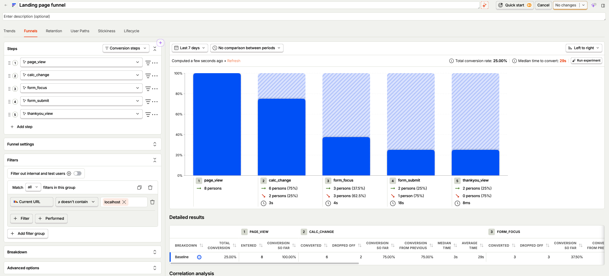

# ETF Landing Page (Clientelo assignment B)

Lead-generation landing page that compares NYSE-listed S&P 500 ETFs for a Czech retail investor. Built with Nuxt, deployed on Vercel.

- Live page: https://etf-landing-tau.vercel.app (ad versions: [`?v=a`](https://etf-landing-tau.vercel.app/?v=a), [`?v=b`](https://etf-landing-tau.vercel.app/?v=b))
- Ad versions: [`/ads/README.md`](./ads/README.md)
- AI conversation exports: [`/ai-log`](./ai-log)

## 1. Assignment in short

Landing page for a Czech retail investor who comes from a mobile ad and gives the page a few seconds. The page has to give value first and collect a contact in exchange. It is judged by one question: could an ad campaign run on it tomorrow?

## 2. Target audience

I picked one person and wrote everything for him:

- Czech, 25 to 40, has a job and some money left every month.
- Already has an account at a broker (XTB, Portu, Trading 212, Degiro) or is about to open one.
- Invests or plans to invest 2 000 to 5 000 CZK a month, long term.
- Has heard that "S&P 500 ETF" is the safe default, but there are several of them and he does not know which one to pick.
- Does not read long articles. He wants a number and a short answer.

I did not target complete beginners (they need to learn what an ETF is first, which is a different page) or active traders (they do not pick funds by fees).

What makes him leave in 3 seconds: a wall of text, a form before any value, anything that looks like a bank or a pushy "finance advisor" page.

## 3. The offer (lead magnet)

**Before any contact:** a fee calculator. He sets how much he invests per month and for how many years. The page immediately shows how much the fees of 3 ETFs eat from his money over that time, in CZK. No form, no scrolling.

**In exchange for the contact:** the full comparison of all 4 funds and their European (UCITS) versions with his numbers from the calculator, sent by e-mail. The page shows 3 funds for free, the e-mail has all of them.

**When I ask for the contact:** right under the calculator result. At that moment he has already got a concrete number about his own money, so the request is not the first thing he sees. Asking before the result would kill most visits.

**Form fields:** only e-mail. The amount and years are already known from the calculator, so I do not ask for them again. A name is not needed for sending the comparison.

**After submit:** the thank-you screen shows the full comparison straight away and says the same thing is in his inbox. Nobody should have to leave the page and go check e-mail to get what he was promised.

## 4. Ads

Two versions with two different promises. The first screen of the page uses the same promise as the ad the visitor came from.

|                      | Version A: fees                                               | Version B: choice                                               |
| -------------------- | ------------------------------------------------------------- | --------------------------------------------------------------- |
| Promise              | You see what the fee costs you in CZK, not in percent         | Same index in all three, so the only real difference is the fee |
| Headline (ad + page) | Kolik vás stojí poplatek ETF? U SPY za 20 let přes 16 000 Kč. | Který S&P 500 ETF si vybrat? Stejný index, jiné poplatky.       |

Ad and page use the same headline word for word. The 16 000 Kč in A is SPY's fees at the calculator defaults (3 000 Kč a month, 20 years), computed from `/data/etfs.json` and rounded down; a unit test fails if the data ever changes it.

The page reads the `?v=a` / `?v=b` URL parameter and switches the headline. Default without the parameter is version A. Full ad texts are in [`/ads/README.md`](./ads/README.md).

## 5. Page structure

| #   | Section                                                          | What it does for the visitor                                                  | Why here                                                               |
| --- | ---------------------------------------------------------------- | ----------------------------------------------------------------------------- | ---------------------------------------------------------------------- |
| 1   | Headline + calculator                                            | Continues the ad promise and gives him something to do in the first 3 seconds | He came for one thing, so it is the first thing on the screen          |
| 2   | Result                                                           | Shows the end value and the fees paid in CZK, visible on load for 3 000 CZK / 20 years, then for his own numbers | This is the value. Everything before the form has to be earned here    |
| 3   | Form (e-mail only, consent sentence under the button)            | Offers the full comparison with his numbers                                   | Directly after the value, while the number is still on the screen      |
| 4   | Short comparison (3 ETFs)                                        | Shows the data behind the calculator so the number is believable              | For people who did not fill the form yet and want to check the numbers |
| 5   | How to buy from CZ                                               | Answers the next question he has: where do I buy it                           | Keeps him on the page instead of googling                              |
| 6   | Second form                                                      | Second chance after the table                                                 | People who scroll past the first form are more convinced here          |
| 7   | Footer: sources, date of data, 7 % assumption, not investment advice | Trust and legal minimum                                                   | Nobody converts from a footer, so it is last                           |

## 6. Interactive elements

**Fee calculator** (sections 1 and 2). Two inputs: monthly amount (slider, 500 to 20 000 CZK, step 500) and years (5, 10, 20, 30). It shows the end value with each fund, the fees paid with each fund, and the difference between the cheapest and the most expensive one. The result is visible on load with 3 000 CZK and 20 years, so the first screen shows a number before he touches anything. The first change of an input is an event (`calc_change`), so I can see how many people try their own numbers.

It leads to the contact because the result is only for 3 funds and the full comparison with the same numbers is behind the e-mail.

Dropped ideas:

- Portfolio builder: too many steps for someone with a few seconds on mobile.
- Full comparison table of 10+ ETFs: on a phone it is a scrolling table, not an argument. The short comparison of 3 funds is enough to make the calculator believable.

## 7. Data and sources

All figures on the page are real and checked by hand against the issuer's page. The data is in [`/data/etfs.json`](./data/etfs.json), each value has its source URL and the date I checked it.

| ETF                                                     | Ticker | TER      | UCITS equivalent    | Issuer page                                                                                          |
| ------------------------------------------------------- | ------ | -------- | ------------------- | ---------------------------------------------------------------------------------------------------- |
| State Street SPDR S&P 500 ETF Trust                     | SPY    | 0.0945 % | SPY5 (IE00B6YX5C33) | [ssga.com](https://www.ssga.com/us/en/intermediary/etfs/spdr-sp-500-etf-trust-spy)                   |
| Vanguard S&P 500 ETF                                    | VOO    | 0.03 %   | VUAA (IE00BFMXXD54) | [investor.vanguard.com](https://investor.vanguard.com/investment-products/etfs/profile/voo)          |
| iShares Core S&P 500 ETF                                | IVV    | 0.03 %   | CSPX (IE00B5BMR087) | [ishares.com](https://www.ishares.com/us/products/239726/ishares-core-sp-500-etf)                    |
| State Street SPDR Portfolio S&P 500 ETF (formerly SPLG) | SPYM   | 0.02 %   | SPYL (IE000XZSV718) | [ssga.com](https://www.ssga.com/us/en/intermediary/etfs/state-street-spdr-portfolio-sp-500-etf-spym) |

All values checked by hand on 2026-10-14 against the issuer page (saved as PDF). Dividend yield is 30 Day SEC Yield for all four funds so they are comparable. Fields per fund: TER, fund size, dividend yield, exchange, and the UCITS ticker, ISIN and TER. `scripts/check-data.mjs` runs before every build and fails it if any value has no source, no check date, or a source outside the issuer's domain (nyse.com allowed only for the exchange field).

**Calculation.** 7 % a year minus the fund's TER, compounded monthly (the yearly rate is turned into the equivalent monthly rate), deposit at the end of each month. No taxes, broker fees or currency conversion. Fees paid = end value with 0 % TER minus end value with the fund's TER. The same formula in a spreadsheet:

```
=FV((1 + (7 - TER)/100)^(1/12) - 1; years*12; -monthly)
```

The code is in [`shared/utils/feeCalc.ts`](./shared/utils/feeCalc.ts), the tests in [`shared/utils/feeCalc.test.ts`](./shared/utils/feeCalc.test.ts). The assumed return is shown on the page next to the result and explained in the footer.

## 8. Measurement

Tool: PostHog (EU cloud, free tier, funnel view). Nothing is stored in the browser (no cookies, no local or session storage), so no cookie banner is needed. That would cost the first screen on mobile. The trade-off: a reload counts as a new visitor, so the funnel only counts paths finished without reloading. IP addresses are discarded in the project settings, and no e-mail is sent in events. PostHog loads only after the page has loaded; events fired before that wait in a queue with their original time.

| Step | Event           | Fired when                                   |
| ---- | --------------- | -------------------------------------------- |
| 1    | `page_view`     | page loads, with the ad version from the URL |
| 2    | `calc_change`   | first change of a calculator input           |
| 3    | `form_focus`    | user taps into the e-mail field              |
| 4    | `form_submit`   | form sent and lead saved                     |
| 5    | `thankyou_view` | thank-you screen shown                       |

Funnel: `page_view` → `calc_change` → `form_focus` → `form_submit` → `thankyou_view`. There is no event for seeing the result: it is on the first screen from the start, and an event fired on load would only repeat `page_view`.



Test run on localhost: 2 page views, 1 full path to thankyou_view.

Leads are stored in Supabase (table `leads`: e-mail, monthly amount, years, ad variant, created_at, updated_at, emailed_at). A repeat submit with the same e-mail updates the row.

The comparison e-mail is sent by Resend from a Nuxt server route, after the lead is saved. One address gets at most one e-mail per 10 minutes, so the form cannot be used to flood someone's inbox. The limit is one atomic database update, so parallel requests cannot get around it.

How I verified it: Went through the whole path on localhost with ?v=b, checked every event in PostHog Activity and the row in Supabase.

## 9. Expected conversion

Estimate for cold traffic from a mobile ad, calculated step by step:

- 100 % arrive and see the result for 3 000 CZK and 20 years right away (`page_view`). About 40 % leave without touching anything (bounce on cold mobile traffic is usually 50 to 70 %, a number on the first screen should keep it lower).
- 60 % change the calculator to their own numbers (`calc_change`).
- About 11 % tap into the form (`form_focus`), mostly people who tried their own numbers, some who only read the default result.
- Of those who start the form, 70 % submit (one field): about 7.5 % (`form_submit`).

**Expected visit-to-lead: 5 to 8 %.** The number depends mostly on how well the ad and the first screen match. I would treat anything under 3 % as a sign that the first screen is wrong, not the form.

This is my estimate from the funnel steps, not a measured number. It needs a few hundred visits to confirm.

## 10. A/B test hypotheses

Ordered by expected impact:

1. **Form before vs. after the result.** Variant: ask for the e-mail to "unlock" the result. Expected: fewer people reach the result, but more of those who do give an e-mail. I expect the current order (result first) to win on leads per visit, but this is the biggest lever on the page, so it has to be tested first. Metric: `form_submit` / `page_view`.
2. **Fee headline vs. choice headline on the first screen.** Same as the two ad versions, but tested on the page with the same ad. Expected: the fee version wins, because a loss in CZK is more concrete than a question. Metric: `calc_change` / `page_view`.
3. **Result visible on load vs. hidden until the first input.** Baseline: the result for 3 000 CZK and 20 years is visible on load. Variant: the result appears only after the first input. Expected: the variant makes more people touch the inputs, but fewer reach the form, so the baseline wins on leads per visit. Metric: `form_submit` / `page_view`.

## 11. Decisions where the assignment was unclear

| Unclear point                                                    | What I decided                                                                                                                                                                                                                     | Why                                                                                                                                |
| ---------------------------------------------------------------- | ---------------------------------------------------------------------------------------------------------------------------------------------------------------------------------------------------------------------------------- | ---------------------------------------------------------------------------------------------------------------------------------- |
| "ETFs traded on NYSE" vs. what a Czech investor can actually buy | Compare the NYSE-listed funds as asked, and in the "How to buy from CZ" section say openly that most EU brokers do not sell US-domiciled ETFs to retail clients (missing KID document) and name the UCITS equivalent for each fund | Hiding this would make the page wrong for the target group. Saying it builds trust and is the kind of thing he would google anyway |
| How many funds to compare                                        | 3 on the page, all 4 with their UCITS versions on the thank-you screen and in the e-mail                                                                                                                                         | 3 fits one phone screen and leaves a reason to give the e-mail                                                                     |
| What return to assume in the calculator                          | 7 % per year before fees, shown next to the result and explained in the footer                                                                                                                                                     | Any number is a guess, so I show it instead of hiding it                                                                           |
| Legal text                                                       | One consent sentence under the submit button instead of a checkbox, and one line "Nejde o investiční doporučení"                                                                                                                  | Keeps the form at one field. It has not been checked by a lawyer (see section 13)                                                  |
| Exchange not stated on the issuer page (VOO)                     | Source is the NYSE listing page (nyse.com) for that fund; the check script allows nyse.com only for this one field                                                                                                                 | The exchange is a fact about the listing, so the exchange itself is the right source. Every other figure stays issuer-only         |
| Fonts                                                            | Self-hosted (IBM Plex Sans and Newsreader, latin and latin-ext only)                                                                                                                                                               | Google Fonts would send every visitor's IP address to Google, which goes against analytics without personal data                   |
| Analytics and the cookie banner                                  | PostHog with memory-only persistence: no cookies, no local or session storage                                                                                                                                                      | No banner on the first screen. The cost is that a reload counts as a new visitor                                                   |
| What if the e-mail fails                                         | The lead is still saved and the thank-you screen still shows the full comparison; the error is logged                                                                                                                              | The visitor gets what was promised either way. A failed e-mail must not lose the lead                                              |
| Result hidden until first input → changed to visible on load | Visible on load with 3 000 CZK and 20 years | I saw the empty space on the live page; the value has to be visible in the first seconds; the funnel is fixed by not firing calc_result on load |

## 12. How I worked with AI

Tools: Claude Code for implementation, Claude (chat) for discussing the approach before I started. Exports of the Claude Code sessions are in [`/ai-log`](./ai-log).

**Process.** Before writing code I worked out the decisions in sections 2–6 (audience, offer, ads, page order) in a separate Claude chat, then read and edited them myself. That README was the brief for Claude Code. I asked for a plan first, not code, answered the agent's questions about it, and then built it step by step with one commit per step.

**Instructions the agents got.**

- Plan and data: read README and assignment, write [`PLAN.md`](./PLAN.md) with one commit per step and a way to verify each, no code; then fill `/data/etfs.json` with a source URL and date for every value. Export: [`ai-log/02-data.md`](./ai-log/02-data.md).
- Calculator: slider 500–20 000 CZK, years 5/10/20/30, 7 % assumption shown next to the result, result hidden until the first change, calculation as a pure function with unit tests. Export: [`ai-log/04-lead-form.md`](./ai-log/04-lead-form.md).
- Form and leads: one e-mail field, consent sentence under the button, upsert on a repeated e-mail, amount, years and ad version from the calculator state, Supabase table `leads`. Export: [`ai-log/04-lead-form.md`](./ai-log/04-lead-form.md).
- Analytics: PostHog EU, the six events from section 8, no cookie banner, no personal data in events. Export: [`ai-log/05-analytics.md`](./ai-log/05-analytics.md).
- Design: propose a visual direction in a few lines first (no gradients, no emoji icons, no stock hero), build only after I approved it, then self-hosted fonts, the comparison, "how to buy from CZ", second form and footer, and a Lighthouse run. Export: [`ai-log/06-design-and-launch.md`](./ai-log/06-design-and-launch.md).
- Launch: headline per ad version, thank-you screen with all 4 funds, the e-mail via Resend, ad texts in `/ads`, push and deploy. Export: [`ai-log/06-design-and-launch.md`](./ai-log/06-design-and-launch.md).

**How I checked the output.**

- Every number in `/data/etfs.json` against the issuer page saved as PDF, by hand.
- The calculator against an independent calculation. I verified it in a separate Claude chat with the FV formula and a month-by-month loop: 3 000 Kč a month, 20 years, TER 0.03 % gives 1 517 433 Kč. The same case is a unit test, "matches independent calculation" in [`shared/utils/feeCalc.test.ts`](./shared/utils/feeCalc.test.ts).
- The form submitted for real, then the row in Supabase, including a repeat submit that updated the same row.
- Every funnel event in PostHog.
- Lighthouse on mobile, production build: Performance 92, Accessibility 100, Best Practices 100, SEO 100.
- The Czech texts read by me. I rewrote the ones I did not like, for example the line above the form, the button text and the hint before the first change.

**Where the AI got it wrong.**

| What happened                                                                                   | How it was found                                  | What I did                                                                                   |
| ----------------------------------------------------------------------------------------------- | ------------------------------------------------- | -------------------------------------------------------------------------------------------- |
| My prompt said Nuxt 3, the repo is Nuxt 4                                                       | Agent asked before planning                       | Kept Nuxt 4                                                                                  |
| The plan promised an e-mail but no step sent one                                                | Agent asked about it while planning               | Added a Resend step                                                                          |
| A slider always has a value, so calc_result would fire on load and the funnel would be useless  | Agent pointed it out                              | Result hidden until first input change                                                       |
| SPLG no longer exists as a ticker (renamed SPYM on 2025-10-31)                                  | Agent found the redirect on the SSGA page         | I confirmed it in SSGA's notice and kept SPYM                                                |
| Vanguard blocks headless browsers, so the agent had no VOO data                                 | Agent reported it instead of guessing             | I saved the page as PDF and filled the values myself                                         |
| I pasted VOO values into the IVV record                                                         | Re-reading the notes: IVV had Vanguard wording    | Fixed by hand; the check script can't catch this                                             |
| Ad A promised "tens of thousands of CZK", the calculator shows 11 061 Kč at 3 000 Kč / 20 years | I compared the ad text with the calculator output | Changed the ad and added total fees paid per fund                                            |
| Google Fonts send the visitor's IP to Google, against my "no personal data" decision            | Agent flagged it                                  | Fonts are self-hosted                                                                        |
| My instruction "latin-ext only" would have broken á, é, í                                       | Agent corrected me                                | Both subsets                                                                                 |
| ?v=a / ?v=b did not switch the headline, only the analytics property                            | Found when I asked the agent to check it          | Fixed and covered by a test                                                                  |
| Performance 71 in Lighthouse: PostHog loaded before the page                                    | Lighthouse                                        | PostHog loads after the page, events queue; now 92                                           |
| The form could be used to flood any inbox with e-mails                                          | Security review by a separate agent               | Limit per address; the second review found a race condition, fixed with one atomic DB update |
| NUXT_MAIL_FROM had no angle brackets and used an unverifiable vercel.app domain | Agent tested against Resend's test address | Verified mail.kubandam.dev |
| Result was hidden until first input, leaving an empty first screen | I noticed it on the live page | Shown on load, funnel event changed |
| My test runs sent localhost events to PostHog because the blocking pattern was wrong | Agent noticed and reported it | Funnel filters out localhost |

## 13. What is missing

- Tested on my phone (iPhone, Safari): both ad variants, result on load, form, thank-you screen, comparison e-mail delivered with working reply-to.
- A privacy policy page. The consent sentence promises deletion on request, and today that is a manual step (the visitor replies to the e-mail). Nobody with legal training has checked the consent text.
- Automatic data refresh. The values are checked by hand. With more time I would add a script that fetches the issuer pages once a month and opens a pull request when a value changes.
- No real traffic yet, so the conversion estimate in section 9 and the A/B hypotheses in section 10 are untested. Only the headline variant can be switched today (by URL); hypotheses 1 and 3 need their variants built first.
- No double opt-in. One address gets at most one e-mail per 10 minutes, but someone could still submit many different addresses once each.

## 14. Run locally

Needs Node 22 and pnpm.

```bash
pnpm install
cp .env.example .env   # fill in the values below
pnpm dev               # http://localhost:3000, /?v=a or /?v=b for the ad versions
pnpm test              # unit tests (Vitest)
pnpm check:data        # data check, also runs before every build
pnpm build             # production build
```

Environment variables (see [`.env.example`](./.env.example)):

| Variable                    | What it is                                                                       |
| --------------------------- | -------------------------------------------------------------------------------- |
| `NUXT_SUPABASE_URL`         | Supabase API URL, `https://<ref>.supabase.co` (not the Postgres connection string) |
| `NUXT_SUPABASE_SERVICE_KEY` | Supabase secret / service_role key, server only                                  |
| `NUXT_PUBLIC_POSTHOG_KEY`   | PostHog project key. Empty = no tracking, events are only logged in the console  |
| `NUXT_PUBLIC_POSTHOG_HOST`  | `https://eu.i.posthog.com`                                                       |
| `NUXT_RESEND_API_KEY`       | Resend API key, server only. Empty = no e-mail, the rest works                   |
| `NUXT_MAIL_FROM`            | Sender on a domain verified in Resend, e.g. `Porovnání ETF <porovnani@example.cz>` |
| `NUXT_MAIL_REPLY_TO`        | Inbox for replies to the e-mail (people reply to get their address deleted)    |

Database: run [`supabase/leads.sql`](./supabase/leads.sql) once in the Supabase SQL editor. A database created before the e-mail limit also needs [`supabase/002-emailed-at.sql`](./supabase/002-emailed-at.sql).

## Repository layout

```
/ads        both ad versions
/ai-log     exported Claude Code conversations
/app        Nuxt app: page, components, composables, PostHog plugin, CSS
/data       ETF data with sources and dates
/docs       funnel screenshot
/public     self-hosted fonts
/scripts    data check that runs before every build
/server     API route for leads, Supabase, e-mail template and Resend
/shared     calculator, formatting, Czech texts, types (used by app and server)
/supabase   SQL for the leads table
PLAN.md     implementation plan
assignment.md
```
